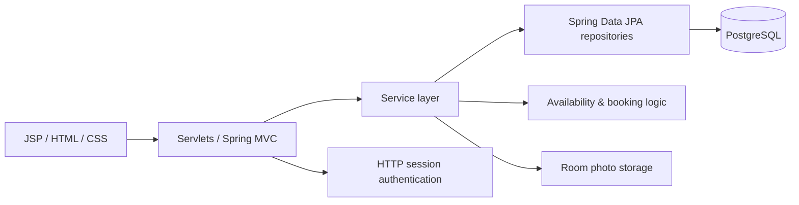

# Hotel Booking System

[](https://www.oracle.com/java/)
[](https://spring.io/)
[](https://www.postgresql.org/)
[](https://github.com/aliipri/hotel-booking-system/actions/workflows/ci.yml)

A Java web application for hotel room browsing and booking, built with Spring, Spring Data JPA, Hibernate, PostgreSQL, Servlets and JSP.

The project demonstrates a classic layered web architecture with persistence, session-based authentication, room availability checks, reservations, image upload and a small REST endpoint for administrative reservation data.

## Highlights

- user registration and session-based authentication;
- BCrypt password hashing;
- room catalog with photos stored in PostgreSQL;
- room availability checks for selected dates;
- reservation creation and user reservation history;
- cart functionality for rooms;
- layered architecture with service and repository layers;
- Spring Data JPA / Hibernate persistence;
- PostgreSQL database;
- JSON REST endpoint for reservation administration;
- Docker Compose setup for local launch;
- GitHub Actions build workflow.

## Tech stack

**Backend:** Java 17, Spring Framework, Spring Boot 2.7, Spring MVC, Spring Data JPA, Hibernate  
**Database:** PostgreSQL  
**Web:** Servlets, JSP, JSTL, HTML, CSS, JavaScript  
**Security:** BCrypt password hashing, HTTP session authentication  
**Build:** Maven  
**Infrastructure:** Docker, Docker Compose, GitHub Actions

## Main features

### Authentication and users

Users can register and sign in to the application. A user account is linked to a guest profile containing contact information.

Passwords are stored as BCrypt hashes rather than plain text.

### Room catalog

The application displays available hotel rooms with descriptions, prices and uploaded photos. Room images are stored as binary data in PostgreSQL and rendered in the UI as Base64-encoded content.

### Booking workflow

A signed-in user can select a room and booking period. Before creating a reservation, the service checks existing reservations for overlapping dates.

The reservation flow stores:

- guest;
- room;
- check-in date;
- check-out date;
- reservation creation timestamp.

### Reservation history

After authentication, users can view their active reservations and related room information.

### Room photo upload

The application supports multipart image upload for rooms. Images are persisted in the database through the service and repository layers.

### REST endpoint

Administrative reservation data can be returned as JSON through:

```text
GET /admin/reservations
```

The endpoint requires an authenticated user with the `ADMIN` role.

## Architecture



The project follows a layered structure:

```text
Web layer -> Service layer -> Repository layer -> PostgreSQL
```

Main domain entities:

- `User`
- `Guest`
- `Room`
- `RoomPhoto`
- `Reservation`
- `CartItem`

## Project structure

```text
hotel-booking-system/
├── .github/
│   └── workflows/          GitHub Actions CI
├── src/
│   └── main/
│       ├── java/hotel/
│       │   ├── controller/ REST controllers
│       │   ├── dto/        DTOs
│       │   ├── model/      JPA entities
│       │   ├── repository/ persistence layer
│       │   ├── service/    business logic
│       │   └── *.java      servlet-based web layer
│       ├── resources/
│       │   └── application.properties
│       └── webapp/
│           ├── WEB-INF/    Spring and servlet configuration
│           ├── css/
│           ├── images/
│           ├── js/
│           └── *.jsp
├── .env.example
├── .gitignore
├── Dockerfile
├── docker-compose.yml
├── pom.xml
└── README.md
```

## Run with Docker Compose

### Requirements

- Docker
- Docker Compose

Clone the repository:

```bash
git clone https://github.com/aliipri/hotel-booking-system.git
cd hotel-booking-system
```

Start the application and PostgreSQL:

```bash
docker compose up --build
```

Open:

```text
http://localhost:8080
```

By default the local development database uses:

```text
Database: hotel_booking
Username: postgres
Password: postgres
```

You can override these values with environment variables or a local `.env` file. See [`.env.example`](.env.example).

## Run without Docker

Requirements:

- Java 17+
- Maven 3.9+
- PostgreSQL
- Tomcat 9

Set database environment variables if necessary:

```text
DB_URL=jdbc:postgresql://localhost:5432/hotel_booking
DB_USERNAME=postgres
DB_PASSWORD=postgres
```

Build the WAR file:

```bash
mvn clean package
```

Deploy the generated WAR from `target/` to Tomcat 9.

## Configuration

Database configuration is externalized through environment variables:

```properties
DB_URL=jdbc:postgresql://localhost:5432/hotel_booking
DB_USERNAME=postgres
DB_PASSWORD=postgres
```

Credentials are intentionally not hard-coded in the public repository.

## Booking logic

The availability check rejects a booking when the requested period overlaps an existing reservation for the same room.

A reservation is created only when:

- the room exists;
- the guest exists;
- the check-out date is later than the check-in date;
- the room is free for the selected period.

Reservation creation is executed in the service layer within a transaction.

## Public-repository cleanup

Before publication, the project was prepared for public GitHub use:

- IDE metadata and build artifacts were removed;
- database credentials were moved to environment-based configuration;
- plaintext password storage was replaced with BCrypt hashing;
- cart persistence was moved under Spring Data JPA instead of a separate manual `EntityManager` configuration;
- reservation ID types were aligned with the entity model;
- guest lookup during reservation creation was corrected;
- Docker configuration was updated for reproducible local startup.

## Possible next improvements

- migrate authentication and authorization to Spring Security;
- add automated unit and integration tests for booking conflicts and authentication;
- add validation DTOs for web forms;
- migrate JSP/Servlet UI to a modern frontend or Thymeleaf;
- add database migrations with Flyway or Liquibase;
- add optimistic or pessimistic locking for concurrent booking requests.

## Author

**Alina Prilepo**  
Java Backend Developer  
Moscow

Main interests: Java backend development, Spring ecosystem, relational databases and application architecture.
